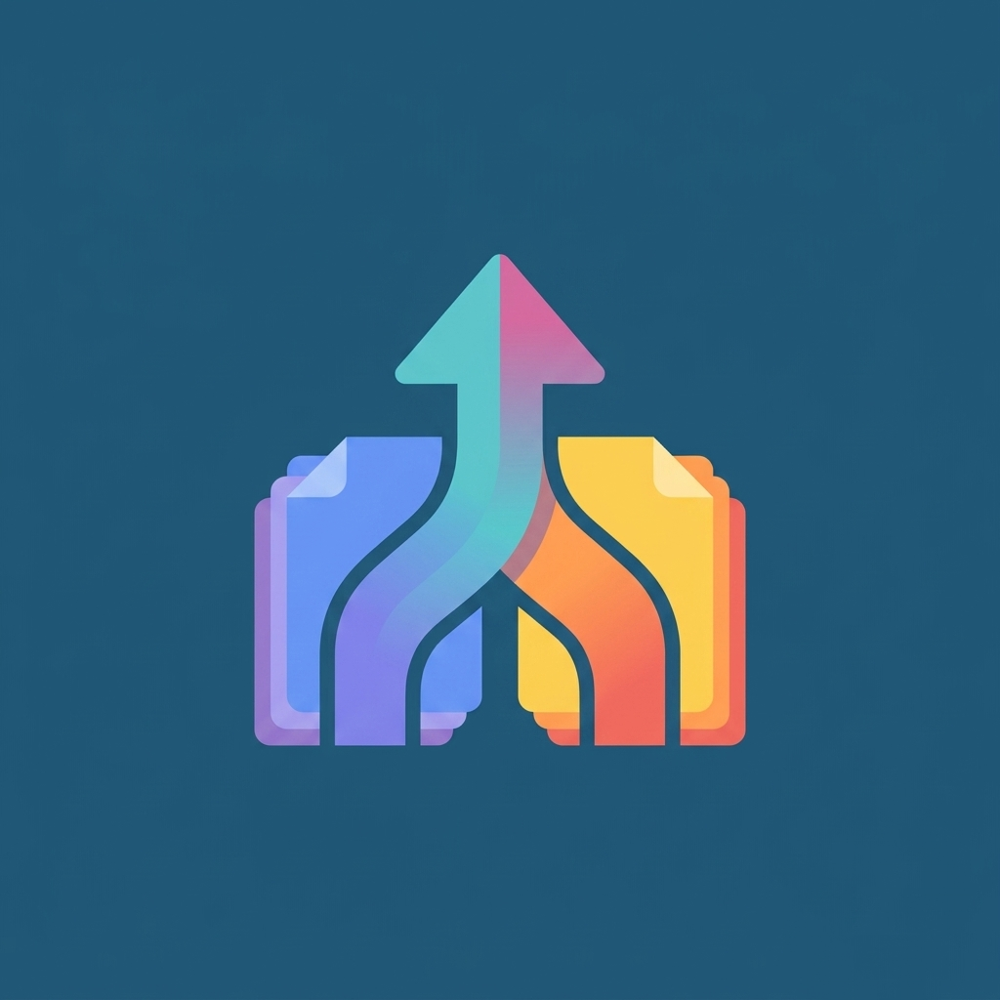

<div align="center">



# Merge PDFs

**Combine multiple PDF files into one, right in your browser.**
A single HTML file. No server, no uploads, no sign-up.


[](https://github.com/USERNAME/REPO/pulls)

</div>

---

## Features

- **Pick many PDFs at once**, or drag and drop them onto the page.
- **Drag to reorder** with a handle on each row. The list auto-scrolls near the screen edges.
- **Live details** for each file: page count and size.
- **Problem files are flagged** (password-protected or unreadable) and skipped.
- **Progress sheet** with a percentage, a progress bar, and file and page counters.
- **Automatic download** when the merge finishes, plus a Save button to download again.
- **Private by design.** Files are processed in your browser and never uploaded.
- **Material 3 dark theme** built on CSS variables, so it's easy to re-theme.

## Quick start

1. Download `index.html` (or `pdf-merger.html`).
2. Open it in Chrome.
3. Tap **Select PDF files**, arrange the order, and press **Merge**.

### Open locally on Android

Open the file from your file manager with Chrome. If the picker or download misbehaves, open it by address instead:

```
file:///storage/emulated/0/Download/index.html
```

### Host it on GitHub Pages

1. Make sure the file is named `index.html` in the repo root.
2. Go to **Settings → Pages**, choose your branch and the `/ (root)` folder, then save.
3. Your app will be live at `https://USERNAME.github.io/REPO/`.

## Offline use

The page loads [pdf-lib](https://github.com/Hopding/pdf-lib) from a CDN, so it needs internet the first time. To work fully offline:

1. Download `pdf-lib.min.js` and place it next to `index.html`.
2. Change the script tag in `index.html`:

```html
<script src="pdf-lib.min.js"></script>
```

## Theming

All colors come from CSS variables at the top of the file, with Material 3 token fallbacks:

```css
:root {
  --bg: var(--md-surfaceVariant, #22271E);
  --fg: var(--md-onSurface, #E2E8D9);
  --acc: var(--md-secondary, #BCCBB1);
  /* ... */
}
```

Change the fallback values to re-theme the whole app.

## Built with

| Piece | Purpose |
| --- | --- |
| HTML, CSS, vanilla JS | The entire UI in one file |
| [pdf-lib](https://github.com/Hopding/pdf-lib) | Reading and merging PDFs in the browser |
| Pointer Events | Touch and mouse drag-to-reorder |

## Limitations

- Everything is held in memory, so very large PDFs (hundreds of MB) may fail on low-memory phones.
- Password-protected PDFs can't be merged. Remove the password first.
- Merging keeps pages as they are. It doesn't compress or edit them.

## Project structure

```
.
├── index.html     # the whole app
├── logo.png       # project logo
├── LICENSE
└── README.md
```

## Contributing

Issues and pull requests are welcome. For larger changes, please open an issue first to discuss what you'd like to change.

## License

Released under the [MIT License](LICENSE).

pdf-lib is also MIT licensed.

---

<div align="center">

If this saved you time, consider giving it a ⭐

</div>
